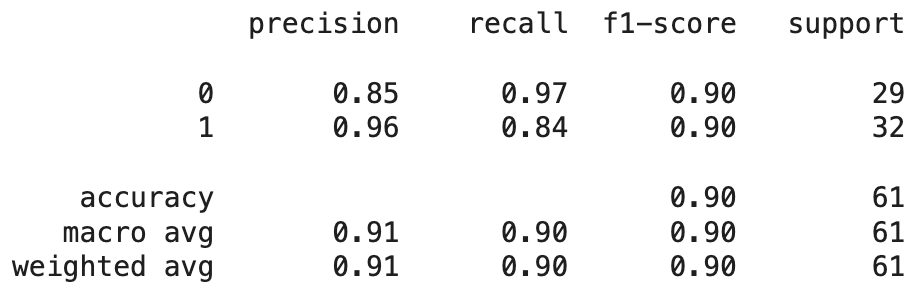
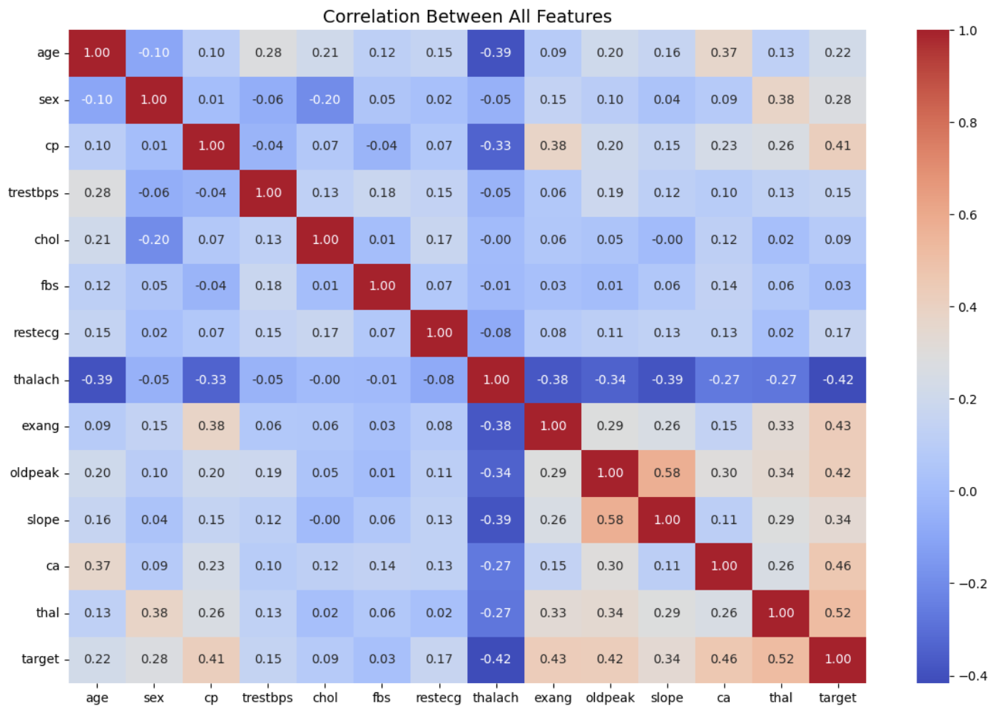
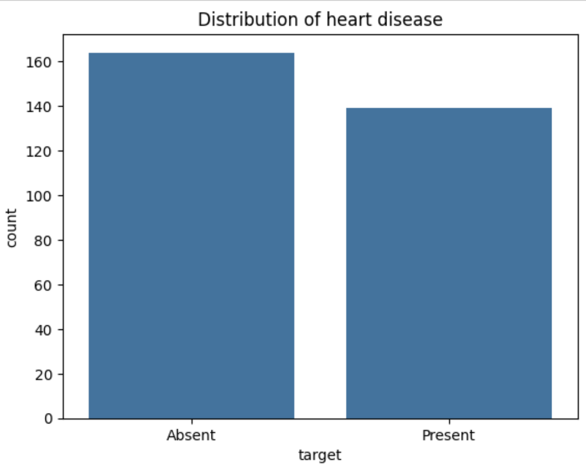

# Heart Disease Risk Prediction

A group project exploring machine learning for heart disease classification using clinical data from UCI Cleveland Heart Disease dataset.

---

## Project Overview

Heart disease is one of the leading causes of death worldwide. Early identification of high-risk patients can help healthcare professionals make more informed decisions and improve patient outcomes.

In this project, we developed a machine learning pipeline to predict heart disease based on patient health indicators. The workflow includes:

- Data Cleaning
- Exploratory Data Analysis (EDA)
- Feature Engineering
- Machine Learning Model Development
- Model Evaluation

---

## Objective

This project aimed to explore clinical features associated with heart disease and build a Random Forest classification model. The project also included a Streamlit interface that allowed users to enter clinical information and view a model prediction.

---

## Dataset

The dataset contains patient cardiovascular health records, including:

- Age
- Sex
- Chest Pain Type
- Resting Blood Pressure
- Cholesterol
- Fasting Blood Sugar
- Resting ECG Results
- Maximum Heart Rate
- Exercise-Induced Angina
- ST Depression
- Number of Major Vessels
- Thalassemia

### Target Variable

| Value | Meaning |
|---------|---------|
| 0 | No Heart Disease |
| 1 | Heart Disease Present |

---

## 🛠️ Technologies Used

### Programming Language

- Python

### Libraries

- pandas
- NumPy
- scikit-learn
- Matplotlib
- Seaborn

### Machine Learning Model

- Random Forest Classifier

---

## 🔍 Methodology

### 1. Data Preprocessing

- Checked for missing values
- Cleaned and transformed data
- Prepared features for model training
- Performed feature selection

### 2. Exploratory Data Analysis (EDA)

- Analyzed feature distributions
- Investigated relationships between variables
- Generated correlation heatmaps
- Explored trends associated with heart disease

### 3. Model Training

- Split data into training and testing sets
- Trained a Random Forest Classifier
- Generated predictions on unseen data

### 4. Model Evaluation

Performance was evaluated using:

- Accuracy
- Confusion Matrix
- Classification Report
- Feature Importance Analysis

---

## Results

### Model Performance

Accuracy: **91%**

```markdown

```

### Key Findings

- Several cardiovascular indicators showed strong predictive power.
- Feature importance analysis identified the most influential health risk factors.
- The Random Forest model achieved strong performance on unseen data.

---

## Visualizations

### Correlation Heatmap

```markdown

```

### Target Distribution

```markdown

```

---

## Future Improvements

- Compare additional machine learning models
- Perform hyperparameter tuning
- Implement cross-validation
- Deploy as a web application
- Train on larger healthcare datasets

---

## My contribution

This was a collaborative group project. I worked with Jocelyn on Random Forest model training and prediction, as documented in the project notebook. Other team members worked on the frontend application.

---

## Disclaimer

This project was created for educational purposes only and should not be used as a medical diagnostic tool.

---
